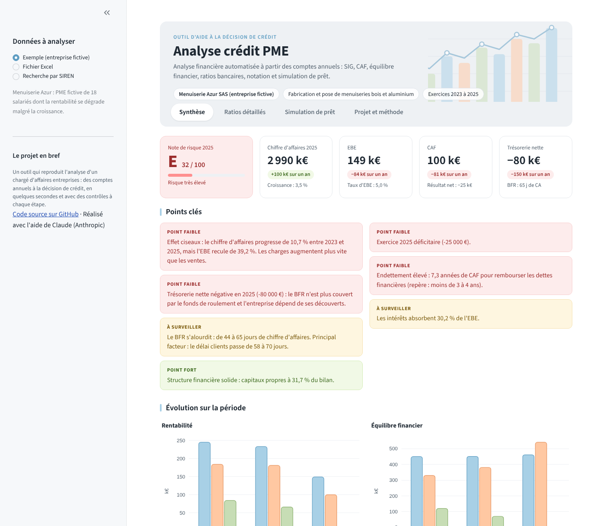

# Analyse crédit automatisée de PME

[](https://analyse-credit-pme.streamlit.app)

**Application en ligne : [analyse-credit-pme.streamlit.app](https://analyse-credit-pme.streamlit.app)** — testez l'outil sans rien installer (exemple fictif, import Excel ou recherche par SIREN).

Outil Python qui reproduit l'analyse financière d'un chargé d'affaires entreprises à partir des comptes annuels d'une PME française :

- **Soldes intermédiaires de gestion** (marge commerciale, valeur ajoutée, EBE, résultat d'exploitation, résultat net)
- **Capacité d'autofinancement** (méthode additive, vérifiée par la méthode soustractive dans les tests)
- **Bilan fonctionnel** : FRNG, BFR, trésorerie nette
- **Ratios bancaires** : autonomie financière, gearing, levier DFN/EBE, capacité de remboursement, délais clients et fournisseurs, liquidité
- **Notation du risque** de A à E, avec des feux tricolores par critère
- **Simulation d'un nouveau prêt** : mensualité, tableau d'amortissement, taux de couverture des annuités par la CAF, montant maximal finançable
- **Note de crédit en PDF** (3 pages, format comité de crédit) : synthèse, points clés, analyse sur trois exercices, détail de la notation, capacité de remboursement et proposition d'avis

> Projet réalisé avec l'aide de Claude (Anthropic).



## Application web

Une interface web permet d'utiliser l'outil sans rien installer : choix d'un exemple, import du modèle Excel ou recherche par SIREN ; note de risque, constats rédigés automatiquement (points forts, points faibles, points à surveiller), graphiques interactifs, cascade des soldes intermédiaires de gestion, ratios avec définition et traduction anglaise, simulateur de prêt avec montant maximal finançable et tableau de sensibilité.

```bash
pip install -r requirements.txt
streamlit run app.py
``` Les seuils de notation sont des repères pédagogiques usuels : ils ne reproduisent la grille d'aucune banque et doivent être adaptés au secteur.

## Lancer l'analyse

Nécessite Python 3.10 ou plus récent.

```bash
python analyser.py exemples/menuiserie_azur.json
python analyser.py exemples/menuiserie_azur.xlsx
python analyser.py exemples/menuiserie_azur.xlsx --pdf note_credit.pdf
python -m pytest
```

## Analyser une entreprise à partir de son SIREN

L'outil récupère automatiquement les comptes publics de l'entreprise :

- **identité** (nom, activité, effectif, siège) : [API Recherche d'entreprises](https://recherche-entreprises.api.gouv.fr/docs/), gratuite et sans compte ;
- **comptes annuels détaillés** : API comptes annuels de l'[INPI](https://data.inpi.fr), gratuite après création d'un compte.

```bash
cp env.exemple .env       # puis indiquez vos identifiants data.inpi.fr dans .env
python recuperer.py 552032534
```

Le programme crée un Excel pré-rempli dans `dossiers/` (jamais publié sur GitHub), signale les points à vérifier, puis lance l'analyse.

**Fiabilité des données.** Chaque bloc (actif, passif, compte de résultat) est contrôlé : la somme des postes doit retrouver le total de la liasse et le résultat net recalculé doit égaler celui déclaré. Le chiffre d'affaires est comparé à celui de l'annuaire des entreprises. Les exercices de durée différente de 12 mois sont signalés.

**Limites.** Environ 45 % des dépôts sont accompagnés d'une déclaration de confidentialité (source : INPI), souvent sur le compte de résultat : l'Excel est alors à compléter avec la liasse fournie par le client. Les comptes simplifiés ne distinguent pas les découverts des emprunts. Les comptes consolidés ne sont pas pris en charge.

## Analyser une entreprise avec Excel

1. Copiez `modeles/modele_liasse.xlsx` et renommez la copie.
2. Remplissez l'onglet **Dossier** (entreprise, demande de crédit) et l'onglet **Comptes** (jusqu'à 3 exercices, à partir de la liasse fiscale).
3. Vérifiez que le bloc **Contrôles** affiche « Bilan équilibré » pour chaque année.
4. Lancez `python analyser.py ma_copie.xlsx`.

Un exemple rempli est disponible : `exemples/menuiserie_azur.xlsx`.

## Structure

```
app.py                # application web (Streamlit)
analyser.py           # analyse en ligne de commande
recuperer.py          # récupération par SIREN en ligne de commande
interface/            # style, couleurs et composants visuels de l'application
analyse_credit/
  modele.py           # postes de la liasse fiscale simplifiée
  analyse.py          # SIG, CAF, bilan fonctionnel, ratios
  scoring.py          # grille de notation et seuils (commentés)
  simulation_pret.py  # mensualités et soutenabilité d'un prêt
  postes.py           # liste des postes du modèle Excel
  import_excel.py     # lecture du modèle Excel
  export_excel.py     # création d'un Excel pré-rempli
  commentaires.py     # constats rédigés automatiquement à partir des ratios
  glossaire.py        # définition de chaque indicateur (FR / EN)
  note_credit.py      # note de crédit au format PDF
  sources/            # API Recherche d'entreprises et INPI, conversion de la liasse
modeles/
  modele_liasse.xlsx  # modèle vierge à remplir
outils/
  generer_modele.py   # régénère le modèle et l'exemple Excel
exemples/
  menuiserie_azur.json  # dossier fictif sur 3 exercices
  menuiserie_azur.xlsx  # le même dossier au format Excel
tests/
```

## Feuille de route

- [x] Étape 1 : moteur d'analyse et notation
- [x] Étape 2 : import depuis un modèle Excel de liasse fiscale
- [x] Étape 3 : récupération automatique des comptes publics à partir du SIREN (INPI, API Recherche d'entreprises)
- [x] Étape 4 : application web (Streamlit) avec graphiques
- [x] Étape 5 : génération de la note de crédit en PDF
- [ ] Étape 6 : modèle de prédiction des défaillances (BODACC)

## Licence

MIT. Voir le fichier `LICENSE`.
